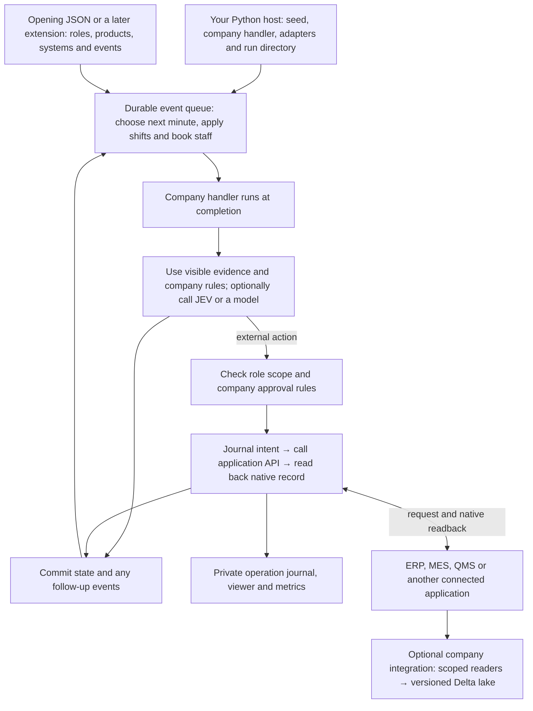
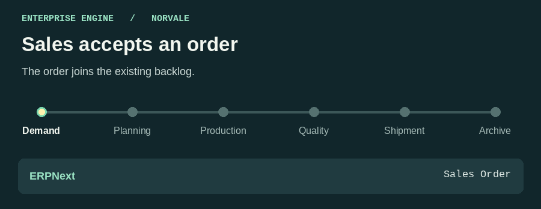

# EnterpriseEngine

[Release workflow and repository ownership](MAINTAINING.md)
**How do you test an enterprise agent when you can’t give it the enterprise’s real history?** A shipment table can tell you that a lot moved. To judge whether the warehouse *should have moved it*, you also need the quality approval that was current at dispatch, the lot it covered, who had release authority, and what the warehouse could see at that minute. Live company data is often private, scattered across applications, or missing that history altogether.

EnterpriseEngine is a Python library for creating those histories in a controlled company. You supply an opening state, roles, working hours, external events and rules for acting. The engine advances business time, runs those rules and persists the consequences. Connect native software when an action needs an independently verifiable record. An investigator can then work from the observable evidence while an evaluator keeps the answer and its provenance private.

**What would that let you test?** In one isolated quality workflow a lot measured **7.2** against a **5.0–6.0** specification. After rework, a new inspection measured **5.5**. The analyst still lacked release authority. The approver released 100 units and later revoked that release. An agent answering “can we ship?” must recover *which inspection, which signer and which point in time*. A second exercise puts two facts in separate expert mailboxes. The planner must ask both people and cite their replies to justify the earliest feasible date. [Native quality qualification](packages/environments/src/environments/norvale/integrations/qms/README.md) · [Expert exercise and checker](docs/EXPERT-INBOX.md)

## How the engine works



The clock owns *when*. Your handler owns *what should happen*. The adapter owns *how to perform and verify it in a particular application*. A database commit, an employee’s permission to approve a purchase, and the date that approval becomes effective are three different facts. [Engine architecture and recovery](docs/ENGINE-ARCHITECTURE.md)

## Install and use from Python

Once `v0.3.0` is tagged, use the following commands on Linux or macOS with Python 3.10+, Git and SQLite to install that release from GitHub.

```sh
python3 -m venv .venv
. .venv/bin/activate
python -m pip install "enterpriseengine @ git+https://github.com/debsagar/enterpriseengine.git@v0.3.0#subdirectory=packages/engine"
```

**Save this as `my_company.py` in your own directory.** The company below has one quality reviewer. Two inspection requests arrive before opening. The handler records what the reviewer discovers and when. It needs neither Docker nor model credentials.

```python
from time import monotonic
from enterpriseengine import Engine


class QualityDesk:
    config = {}

    def handle(self, run, kind, payload):
        if kind != "inspect":
            raise ValueError(kind)
        sample = payload["ph"]
        result = "in range" if 5.0 <= sample <= 6.0 else "out of range"
        run.state.setdefault("inspections", {})[payload["lot"]] = [run.now, result]


company = Engine("quality-run", QualityDesk(), seed=42, native=None,
                 providers=None, monotonic=monotonic)
company.extend(
    "opening-v1",
    roles={"analyst": {"shifts": [[540, 1020]], "staff": 1}},
    events=[
        {"id": "sample-A", "kind": "inspect", "at": 525, "duration": 10,
         "role": "analyst", "payload": {"lot": "A", "ph": 7.2}},
        {"id": "sample-B", "kind": "inspect", "at": 525, "duration": 10,
         "role": "analyst", "payload": {"lot": "B", "ph": 5.5}},
    ],
)
company.run(until=560)
print(company.state["inspections"])
```

Run `python my_company.py`. The result is `{'A': [550, 'out of range'], 'B': [560, 'in range']}`. The first result arrives at 09:10 and the second at 09:20. Run it again and the same two results are recovered. This small company models measurements only. The native example above adds the separate QA decision, permissions, physical stock and independent records.

## Write an opening in JSON

From a Linux or other supported POSIX checkout with Python 3.10+, SQLite and uv, run the following. This example uses the standard library and needs no accounts or services.

```sh
git clone https://github.com/debsagar/enterpriseengine.git
cd enterpriseengine
uv sync --locked --all-packages
uv run python -m docs.examples.first_run --run ./runs/desk --until 550
uv run python -m docs.examples.first_run --run ./runs/desk --until 560
```

The first command that runs the engine completes A at 09:10. The second reopens the same checkpoint and completes B at 09:20. Its output is:

```json
[{"case": "A", "start": 540, "finish": 550}, {"case": "B", "start": 550, "finish": 560}]
```

### 1. Describe the opening work in JSON

The file below is the complete input to the example. Minutes are offsets from the clock origin. Minute 525 is 08:45 and the shift opens at minute 540. The `kind` string selects a behavior you implement. The `payload` belongs to that behavior.

```json
{
  "id": "opening-v1",
  "roles": {"reviewer": {"shifts": [[540, 1020]], "staff": 1}},
  "events": [
    {"id": "review-A", "kind": "review", "at": 525, "duration": 10, "role": "reviewer", "payload": {"case": "A"}},
    {"id": "review-B", "kind": "review", "at": 525, "duration": 10, "role": "reviewer", "payload": {"case": "B"}}
  ]
}
```

Try changing `staff` to `2` in a copy of the JSON. Pass it with `--opening your-file.json` and use a **fresh run directory**. Both reviews then finish at 09:10. In an existing run, replaying the same opening ID with changed contents is rejected. [Opening file](docs/examples/first-run/opening.json) · [Field reference and runtime additions](docs/ENGINE-INPUTS.md)

Load that JSON in your host with ordinary Python:

```python
import json
from pathlib import Path

opening = json.loads(Path("docs/examples/first-run/opening.json").read_text())
# run is an Engine whose handler implements the "review" action.
run.extend(opening["id"], roles=opening["roles"], events=opening["events"])
```

[Complete JSON-driven host](docs/examples/first_run.py) · [Constructor, event and catalog fields](docs/ENGINE-INPUTS.md)

## Features and boundaries

| Capability | What it lets you do |
|---|---|
| Business time | Model work across shifts, staff contention, unattended time and simultaneous events. Provider latency does not advance business time. |
| Durable execution | Pause at a cutoff, reopen the same directory, and recover pending work with its original operation identity. |
| Runtime additions | Atomically add roles, products, supported software connections and future work. Existing catalog entries are immutable. |
| Role-scoped decisions | Read evidence as of a business minute. Use deterministic rules for routine work and optionally call JEV or a model for judgment. The host commissions native identities and the company defines approval authority. |
| Outside events | Seed private world processes and expose their observable effects to company roles. [World process model](docs/WORLD-PROCESSES.md) |
| Inspection and grading | Inspect journaled calls, responses and readbacks; export confirmed records; implement company-specific extraction questions and private grading. [Runtime reference](packages/engine/src/engine/README.md) |
| Operational scope | One controller per local run directory. A staff count models capacity. Individually modeled employees need identities, behavior and permissions. A 2,000-person full-stack deployment remains unqualified. |

The [warehouse shortage and managed services SLA examples](docs/OBLIGATION-CASES.md)
show how to carry role-owned commitments through a handoff and restart,
then resolve them with native readback.

## What a world-model experiment gets back

The company produces source records. The learner gets a filtered view and a question with a cutoff. The evaluator can retain private state, native evidence links and a checker. For example, a correct answer to the expert availability exercise needs the later of two dates **and both native message IDs**. Guessing the date earns no evidence credit. In a shipping exercise, the comparable checks are the shipment quantity, the pinned release version and the time at which the role could observe it.

This gives a world-model team a controlled place to test reconstruction and decision support. The simulator’s rules are authored assumptions. Learning an ontology automatically from an arbitrary enterprise, predicting the real outcome of a policy change, or formally proving every possible workflow requires additional work. The historical dataset and isolated native qualifications have distinct coverage. [Dataset provenance](docs/PROVENANCE.md) · [Architecture and replay boundaries](docs/ENGINE-ARCHITECTURE.md)

## Worked application: Norvale

Norvale models a manufacturer with engineering, production, quality, warehouse and finance roles. Follow how those roles use ERPNext, InvenTree, Odoo, a separate QMS and scheduled Delta readers. The generic desk example above and the full-company launcher use different input formats.



- [Write the Norvale scenario in Python](docs/write-norvale.md)
- [Connect employee identities, software APIs and approval authority](docs/roles-and-software.md)
- [Operate the full company and inspect the historical dataset](docs/NORVALE.md)
- [Norvale operating-loop architecture](docs/ARCHITECTURE.md)
